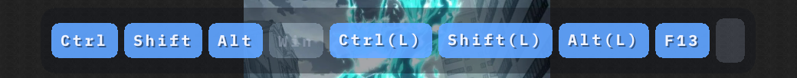
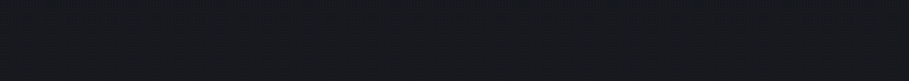
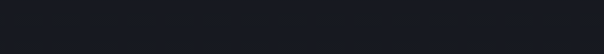

# keyboard-mouse-overlay

Always-on-top, click-through overlay that shows live keyboard and mouse input on Windows.

Rust, raw Win32 (`WS_EX_LAYERED` + `UpdateLayeredWindow`), CPU-rendered frames with `ab_glyph`.
Roadmap and the phase-by-phase plan are in [PLAN.md](PLAN.md).

## Run

Requires the MSVC toolchain and the Windows SDK (`vcbuildtools` workload).

```
cargo run -- --dump                          # print global input as NDJSON
cargo run -- --selftest                      # inject tagged input, check the hook sees it
cargo run -- --overlay                       # the transparent overlay (needs a desktop)
cargo run -- --overlay --theme light         # the light palette
```

```
kmoverlay — keyboard and mouse input overlay

  --dump            print normalised input events to stdout
  --selftest        inject tagged synthetic keys and assert the hook path works
  --overlay         show the transparent overlay window (Ctrl+Alt+Q quits)
  --show-injected   with --overlay, also show synthetic input (demo/screenshot aid)
  --moves           with --dump, also print mouse-move events (noisy)
  --theme <name>    overlay palette: dark (default) or light
  --scale <factor>  overlay size factor, overriding the display scale (capture aid)
  --duration <ms>   stop after this many milliseconds (default: run until killed)
  --help            show this help

Nothing captured here is written to disk.
```

`tools/capture-gif.ps1` records the demos below: it puts a plain window behind the overlay,
drives harmless synthetic F-key/modifier input, grabs the strip region and encodes it with
ffmpeg. Keys are released in `finally`, so it cannot leave a modifier stuck down.

No arguments needs no elevation; the low-level hook follows the UIPI rule explained in
[PLAN.md](PLAN.md). `--selftest` injects tagged input and swallows only its own events, so
F13/F14 never reach whatever has focus.

**Status:** phases 1-2 run on this machine (input capture, 60 Hz transparent click-through
window), and phase 3 draws keycaps, fading history, modifier states, a mouse indicator and
click ripples (IBM Plex Mono embedded, `ab_glyph` on the CPU), in two palettes:



| dark | light |
| --- | --- |
|  |  |
